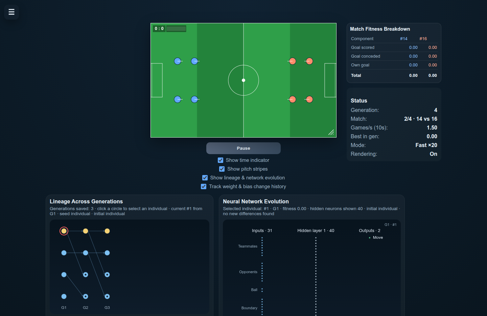
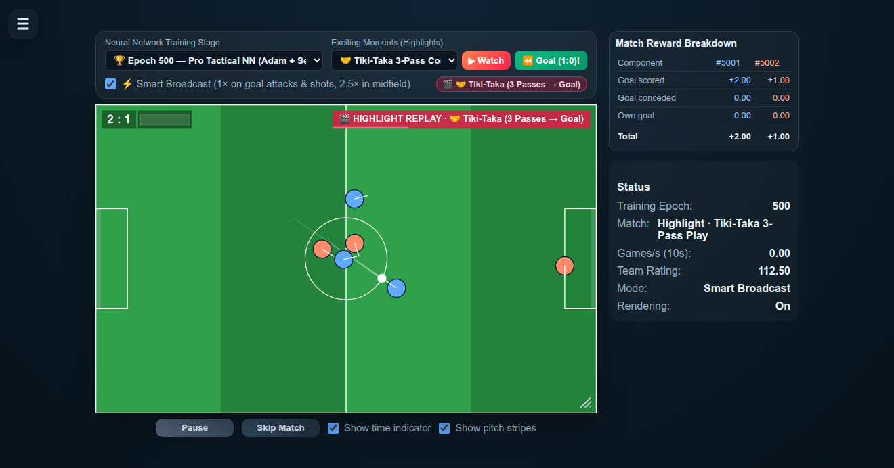

# ⚽ Neural Futsal — Multi-Agent Tactical Football Simulator

[](https://aminadav-ai.github.io/Neural-Futsal/)
[](https://developer.mozilla.org/en-US/docs/Web/JavaScript)
[](https://developer.mozilla.org/en-US/docs/Web/API/Canvas_API)
[](https://developer.mozilla.org/en-US/docs/Web/API/Web_Workers_API)
[](./LICENSE)

**Live Demo:** [https://aminadav-ai.github.io/Neural-Futsal/](https://aminadav-ai.github.io/Neural-Futsal/)

`Neural Futsal` is a zero-dependency browser simulation where 3v3 teams of autonomous neural network agents play fast-paced 2.5D futsal. Each player is controlled by a custom feed-forward **Deep MLP (`24 → 64 → 64 → 4` with `LeakyReLU` + `tanh`)** trained with **Backpropagation (`Adam` optimizer)** and **self-play policy fine-tuning** inside a background **Web Worker**.

---

## 📸 Screenshots

### 1. Live 3v3 Tactical Match & Smart Broadcast Bar


### 2. Highlight Replay & Neural Network Controls


---

## ✨ Key Features

- **Pre-Trained Neural Network Stages (`Epoch 0` to `Epoch 500`):** Launches directly into a **500-epoch `Adam`-trained tactical neural network (`Epoch 500`)** at watchable real-time speed, with a stage selector to compare `Epoch 0 (Untrained Random Weights)`, `Epoch 25 (Early Ball Control)`, `Epoch 100 (Shooting & Dribbling)`, `Epoch 250 (Passing & Wing Overload)`, and `Epoch 500 (Pro Tactical NN)`.
- **Dynamic Tactical Roles & Omnidirectional Ball Physics:** Agents receive 24 ego-centric normalized inputs (relative ball position/velocity, teammate & opponent vectors, open goal corner, and dynamic role encoding `[Attacker, Support Winger, Sweeper]`) and output 4 continuous actions `(vx, vy, kickX, kickY)` for close-control dribbling, diagonal lead passes, and top-corner finishes.
- **⚡ Smart Broadcast Director:** Automatically fast-forwards midfield build-up (`2.6×`) while smoothly dropping to **`1×` real-time speed** whenever players launch a goal attack or fire a shot.
- **🎬 Curated Highlight Reel & Instant Goal Replay:** Watch 5 tactical highlights (*Tiki-Taka 3-Pass Combination Goal*, *Long-Range Top-Corner Rocket*, *Coast-to-Coast Counter-Attack*, *Goal-Line Save & Counter Breakaway*, *Solo Wing Dribble & Far-Corner Finish*) or click **`⏪ Last Goal`** at any time for an instant replay of the most recent live goal.
- **Custom Zero-Dependency Neural Network Engine:** Written from scratch in vanilla JavaScript (ES Modules + Web Worker) with online backpropagation (`trainStep`), reward shaping, and JSON checkpoint export/import.

---

## 🚀 Running Locally

Because the simulator uses ES Modules and a Web Worker (`worker.js`), serve the folder over any local HTTP server:

```bash
git clone https://github.com/aminadav-ai/Neural-Futsal.git
cd Neural-Futsal
python3 -m http.server 8000
```

Then open `http://localhost:8000` in your browser.

---

## 📄 License

This project is licensed under the [MIT License](./LICENSE).
